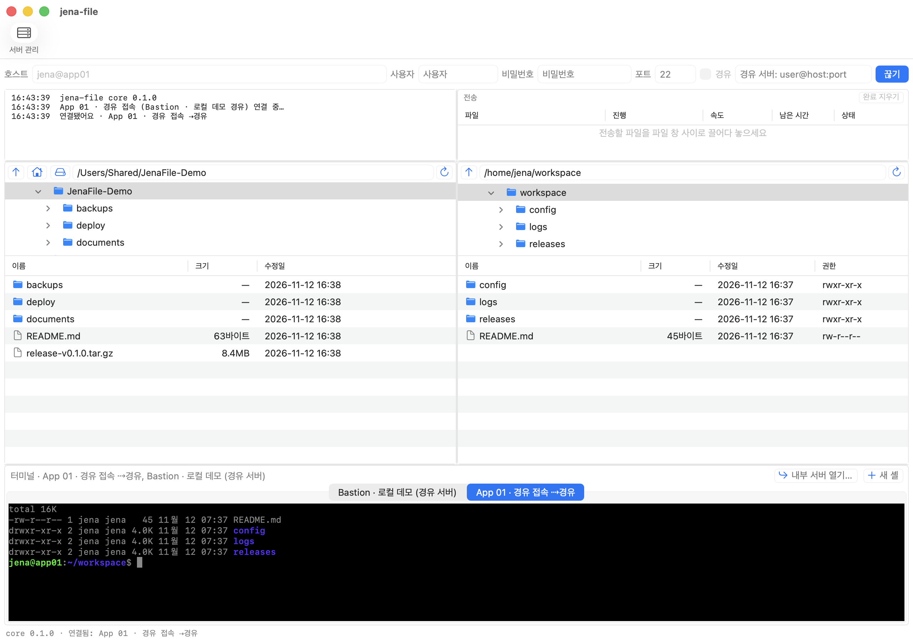
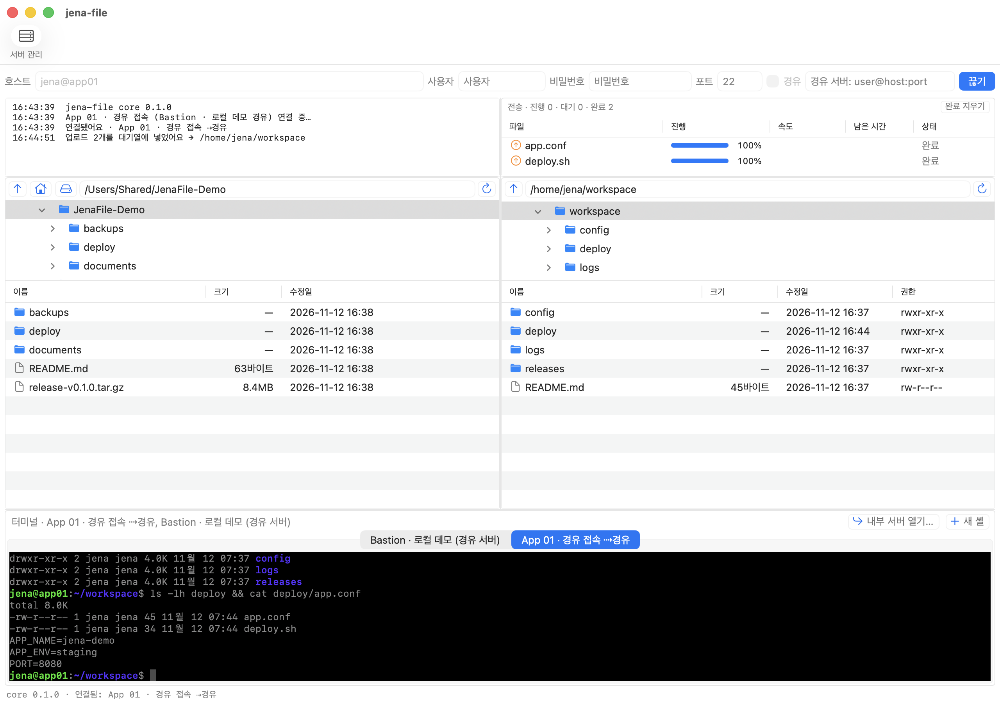
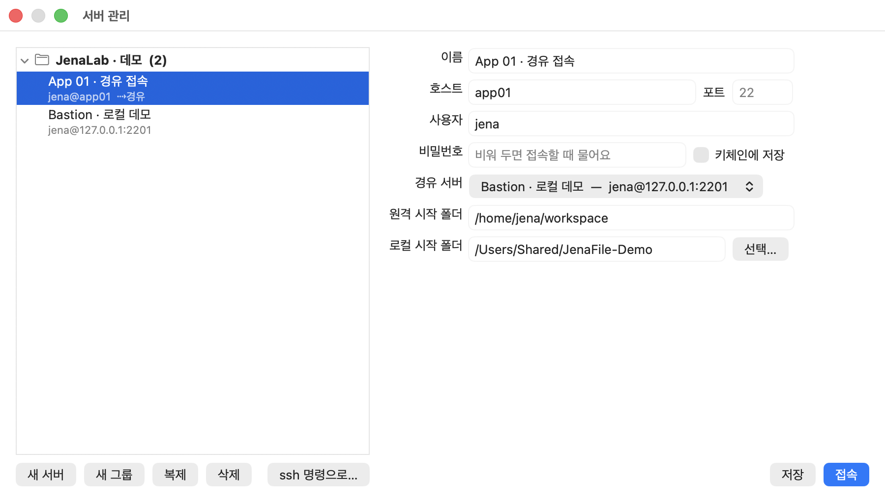
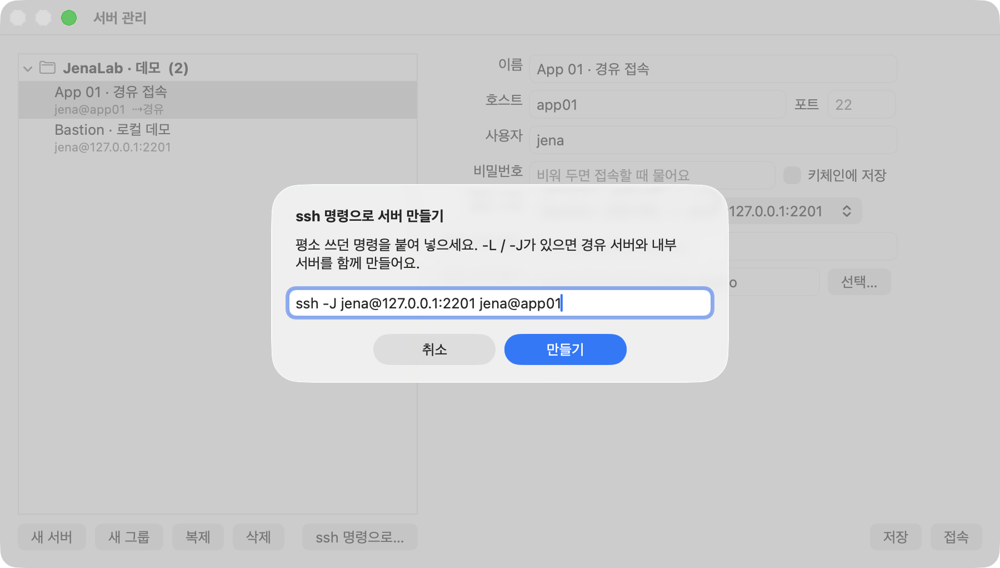
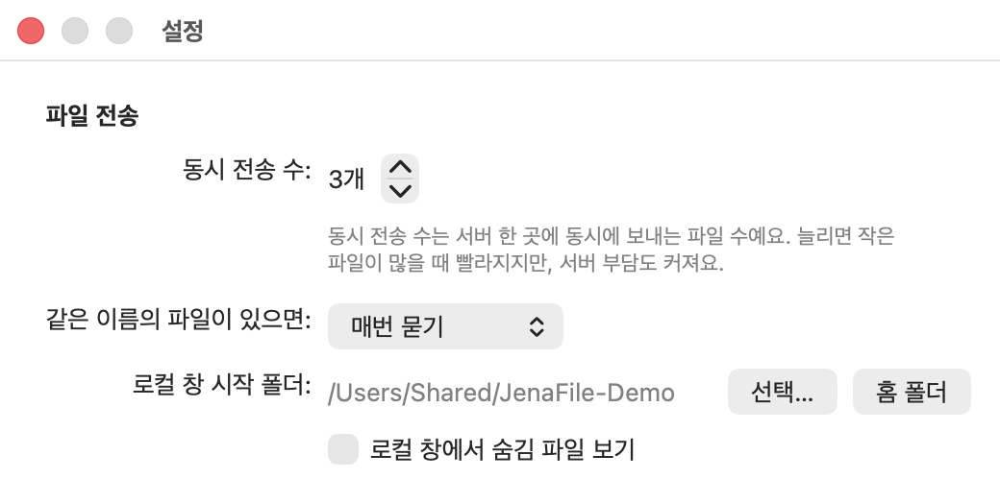
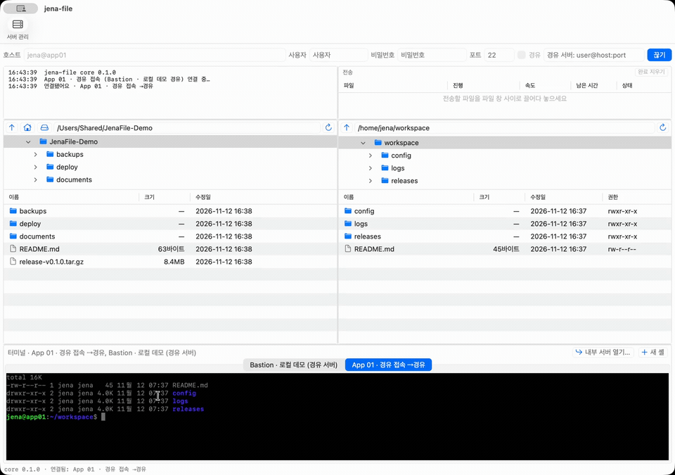
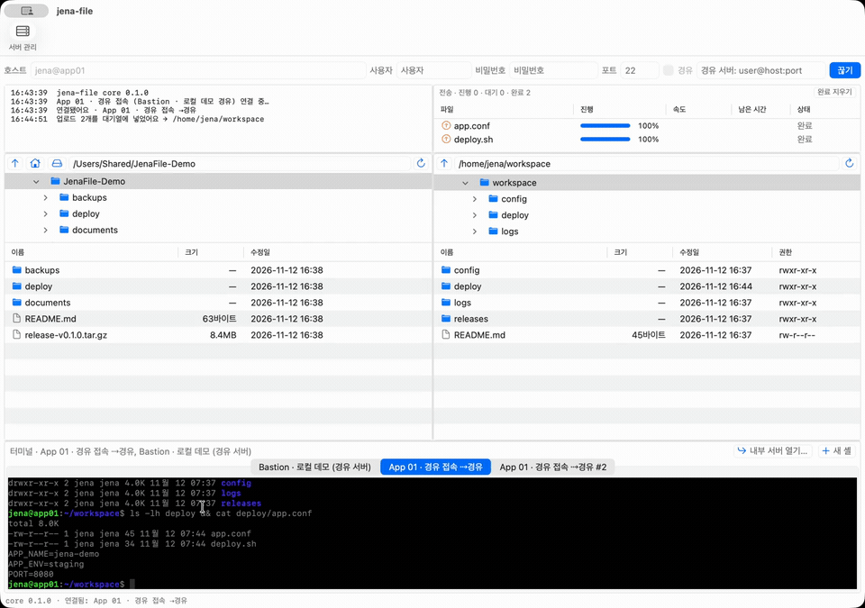
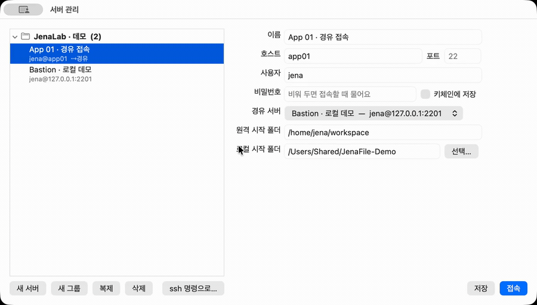

<div align="center">


# jena-file

**Remote file transfer and terminal in one window — a native macOS SFTP app with built-in jump host (bastion) support**

[](https://www.apple.com/macos/)
[](https://swift.org)
[](https://www.rust-lang.org)
[](LICENSE)

[Download](#installation) · [Why jena-file?](#why-jena-file) · [Features](#features) · [Screenshots](#screenshots) · [Build](#build) · [Architecture](#architecture) · [한국어](README.ko.md)

</div>

> Windows and FTP/FTPS support are planned.

## Why jena-file?

Uploading files to a server behind a bastion often means opening an `ssh -L` tunnel in a terminal, then connecting FileZilla to `localhost`. Two windows, two connections. jena-file opens **a file browser and terminal together through one connection**, routing through the bastion without opening a local forwarding port (ProxyJump-style).

## Features

- **Jump host connections** — Optional per server; direct connections are the default. Authenticate to the bastion once, then open multiple internal servers without authenticating to the bastion again
- **Paste an ssh command** — Create bastion and internal server profiles together from your existing `ssh -L …` or `ssh -J …` command
- **File browser + terminal** — Shell tabs share the SSH connection, with Korean input support. Drag remote files into the terminal to insert their paths
- **File transfers** — Concurrent transfer queue, folder transfers, conflict handling (ask, overwrite, rename or skip), pause and resume
- **Recovery after disconnects** — Automatic reconnection and interrupted transfer recovery; unfinished transfers are restored to the queue when the app restarts
- **Server management** — Organize servers in a group tree with drag-and-drop. Passwords are stored only in macOS Keychain
- **Folder navigation** — FileZilla-style folder trees above file lists, with quick access to external disks and network drives
- **Context menus** — Copy names, relative paths or absolute paths, and rename files
- Built-in help (⌘?)
- Korean and English UI

## Screenshots

<p align="center">
  
</p>

| Folder transfer and remote verification | Server management |
|---|---|
|  |  |
| **Paste an ssh command** | **Transfer settings** |
|  |  |

### Demo

| Folder upload and terminal verification | Bastion and internal server terminals |
|---|---|
|  |  |

<p align="center">
  
</p>

MP4: [Folder transfer](assets/transfer.mp4) · [Terminal tabs](assets/terminal.mp4) · [Server management](assets/servers.mp4)

The UI is shown in Korean. These are actual app captures using local Docker test servers and separate demo files. [Capture setup and validation notes (Korean)](assets/README.md).

## Status

**v0.1.0 · MVP phase 1** — Direct and bastion-routed SFTP, terminals, transfers and server management are working. MVP phase 2 will add FTP/FTPS, three simultaneous connections and `~/.ssh/config` import, followed by Developer ID signing, notarization and Windows support.

Project documentation is currently in Korean.

| Document | Contents |
|---|---|
| [Product plan](docs/기획서.md) | Scope, screens, functional requirements, acceptance criteria and decisions |
| [Architecture](docs/ARCHITECTURE.md) | Modules, connection model, concurrency, storage and MVP implementation sequence |
| [russh spike](docs/spike/2026-11-01-russh.md) | Direct and bastion-routed SFTP, authentication and throughput validation |
| [UniFFI spike](docs/spike/2026-11-01-uniffi.md) | Swift ↔ Rust integration with UniFFI and Korean input in SwiftTerm |

## Installation

Download `jenaFile.dmg` from the [latest release](https://github.com/jenalab-com/jena-file/releases/latest), open it and drag `JenaFile.app` into Applications. Requires Apple Silicon (arm64) and macOS 13 or later.

The app is ad-hoc signed and has not yet been notarized. If macOS reports an unidentified developer or says the app is damaged on first launch, use one of these methods:

- In Finder, Control-click `JenaFile.app` → Open → Open
- Or run `xattr -dr com.apple.quarantine /Applications/JenaFile.app` in Terminal

## Build

Requirements: macOS 13+, Xcode (Swift 6) and Rust (rustup).

Install Rust once before running `make run`. If you see `cargo: command not found`, this step is missing:

```sh
curl --proto '=https' --tlsv1.2 -sSf https://sh.rustup.rs | sh   # Install with the default options
. "$HOME/.cargo/env"                                         # Or open a new terminal
cargo --version                                              # Verify the installation
```

Use rustup to install Rust. The build script loads `~/.cargo/env` directly, so it also works before your terminal's PATH has been updated. The first build takes a few minutes to compile dependencies.

```sh
make run        # Build Rust core → xcframework → app (build/JenaFile.app), then launch
make install    # Build and install to /Applications/JenaFile.app (remove with make uninstall)
make dmg        # Create build/jenaFile.dmg for distribution
make test       # Run cargo test + swift test
```

Test SSH servers: [tests/docker/README.md](tests/docker/README.md) (Korean).

## Architecture

- **Core** (`core/`): Rust — SSH/SFTP built on [russh](https://github.com/Eugeny/russh), connections, transfer queue and server profiles
- **UI** (`apps/macos/`): Swift/AppKit with [SwiftTerm](https://github.com/migueldeicaza/SwiftTerm) on macOS; a native C# Windows app is planned
- **Bridge**: [UniFFI](https://github.com/mozilla/uniffi-rs) exposes the Rust core to Swift

`spike/` contains technical experiments, separate from product code. See [spike/README.md](spike/README.md) (Korean) for instructions on running them.

## License

[MIT](LICENSE) © 2026 JenaLab
