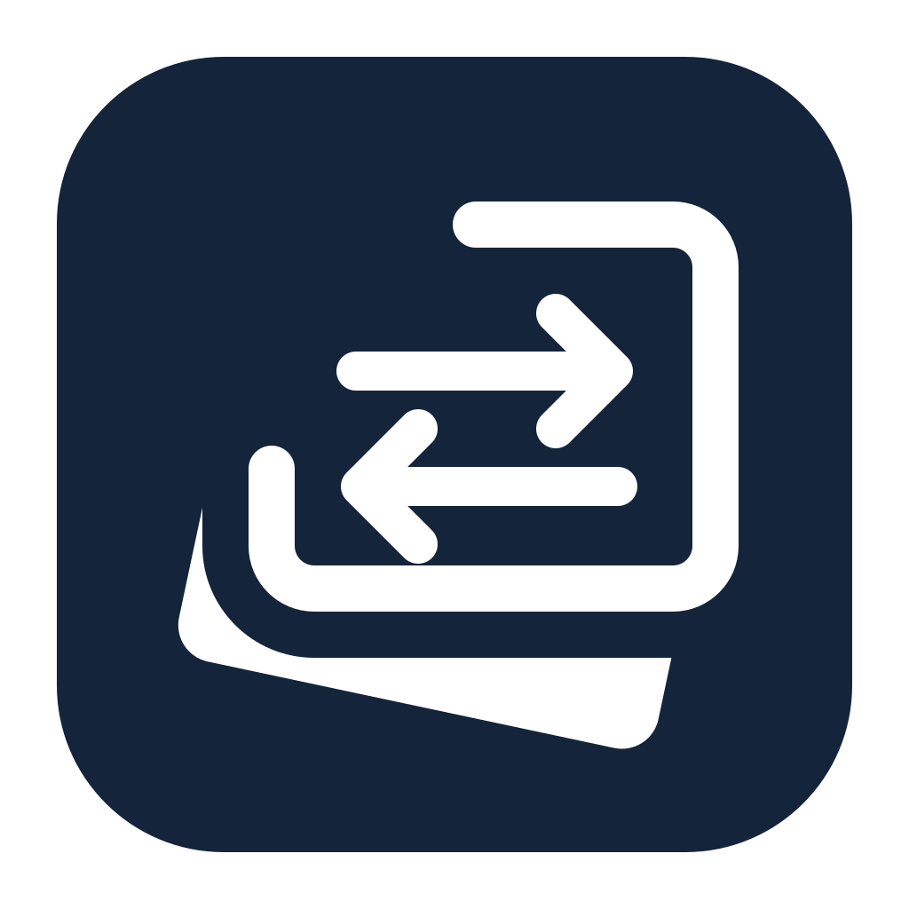

<div align="center">



# jena-file

**원격 파일 전송과 터미널을 한 화면에서 — 경유 서버(bastion) 뒤 서버까지 한 번에 여는 macOS 네이티브 SFTP 앱**

[](https://www.apple.com/macos/)
[](https://swift.org)
[](https://www.rust-lang.org)
[](LICENSE)

[왜 만드나](#왜-만드나) · [주요 기능](#주요-기능) · [빌드](#빌드) · [구조](#구조)

</div>

> Remote file transfer and terminal in one window. A native macOS SFTP client that opens servers behind a jump host (bastion) in one step. Windows and FTP/FTPS are planned.

## 왜 만드나

경유 서버(bastion) 뒤 서버에 파일을 올리려면 지금은 터미널에서 `ssh -L`로 터널을 열고, FileZilla로 `localhost`에 다시 접속해야 한다. 창 두 개, 접속 두 번. jena-file은 **한 번의 접속으로 같은 창에 파일 창과 터미널을 함께** 연다. 로컬 포트를 열지 않고 경유 서버를 거친다(ProxyJump 방식).

## 주요 기능

- **경유 서버 접속** — 서버마다 필요할 때만 켠다(기본은 직접 접속). 경유 서버 인증은 한 번, 그 뒤 내부 서버 여러 대를 다시 로그인 없이 연다
- **ssh 명령 붙여넣기** — 평소 쓰던 `ssh -L …` / `ssh -J …` 명령으로 경유 서버와 내부 서버를 한 번에 만든다
- **파일 창 + 터미널** — 같은 접속 위에 터미널 탭(한글 입력 지원), 원격 파일을 터미널에 끌어다 놓으면 경로 입력
- **전송** — 대기열 동시 전송, 폴더, 같은 이름 처리(묻기·덮어쓰기·이름 바꾸기·건너뛰기), 일시정지·이어받기
- **끊겨도 이어서** — 자동 재연결, 끊긴 전송 자동 이어받기, 앱을 다시 켜면 남은 대기열 복원
- **서버 관리** — 그룹 트리(드래그로 이동), 비밀번호는 macOS 키체인에만 저장
- **로컬 창** — 외장 디스크·네트워크 드라이브 바로 열기
- 한국어 / 영어 화면

## 상태

**MVP 1차 기능 완료 · 실사용 검증 중** — SFTP 직접·경유 접속, 터미널, 전송, 서버 관리까지 동작한다. 다음은 MVP 2차(FTP/FTPS, 동시 3개 연결, `~/.ssh/config` 가져오기), 그 뒤 공개 배포(서명·DMG)와 Windows.

| 문서 | 내용 |
|---|---|
| [docs/기획서.md](docs/기획서.md) | 기획서(범위·화면·기능 요구사항·수용 기준·결정 기록) |
| [docs/ARCHITECTURE.md](docs/ARCHITECTURE.md) | 기술 구조 설계(모듈·연결 모델·동시성·저장·MVP 작업 순서) |
| [docs/spike/2026-11-01-russh.md](docs/spike/2026-11-01-russh.md) | russh 검증 — 직접/경유 SFTP, 인증, 처리량 |
| [docs/spike/2026-11-01-uniffi.md](docs/spike/2026-11-01-uniffi.md) | Swift ↔ Rust(UniFFI) 연결, SwiftTerm 한글 입력 |

## 빌드

필요: macOS 13+, Xcode(Swift 6), Rust(rustup).

처음 한 번, `make run` 전에 Rust를 설치한다(`cargo: command not found`가 나면 이 단계가 빠진 것):

```sh
curl --proto '=https' --tlsv1.2 -sSf https://sh.rustup.rs | sh   # 기본 옵션으로 설치
. "$HOME/.cargo/env"                                             # 또는 터미널 새로 열기
cargo --version                                                  # 설치 확인
```

`brew install rust`가 아니라 rustup을 쓴다. 빌드 스크립트가 `~/.cargo/env`를 직접 불러오므로 PATH 설정 전이어도 동작한다. 첫 빌드는 의존성 컴파일로 몇 분 걸린다.

```sh
make run        # Rust 핵심 → xcframework → 앱 빌드(build/JenaFile.app) → 실행
make test       # cargo test + swift test
```

시험용 SSH 서버: [tests/docker/README.md](tests/docker/README.md)

## 구조

- **핵심** (`core/`): Rust — [russh](https://github.com/Eugeny/russh) 기반 SSH/SFTP, 연결·전송 대기열·서버 목록
- **화면** (`apps/macos/`): macOS는 Swift/AppKit + [SwiftTerm](https://github.com/migueldeicaza/SwiftTerm), Windows는 C# 네이티브(이후)
- **연결**: [UniFFI](https://github.com/mozilla/uniffi-rs)로 Rust 핵심을 Swift에서 호출

`spike/`는 기술 검증용 코드이며 제품 코드가 아니다. 다시 돌리는 법은 [spike/README.md](spike/README.md).

## 라이선스

[MIT](LICENSE) © 2026 JenaLab
